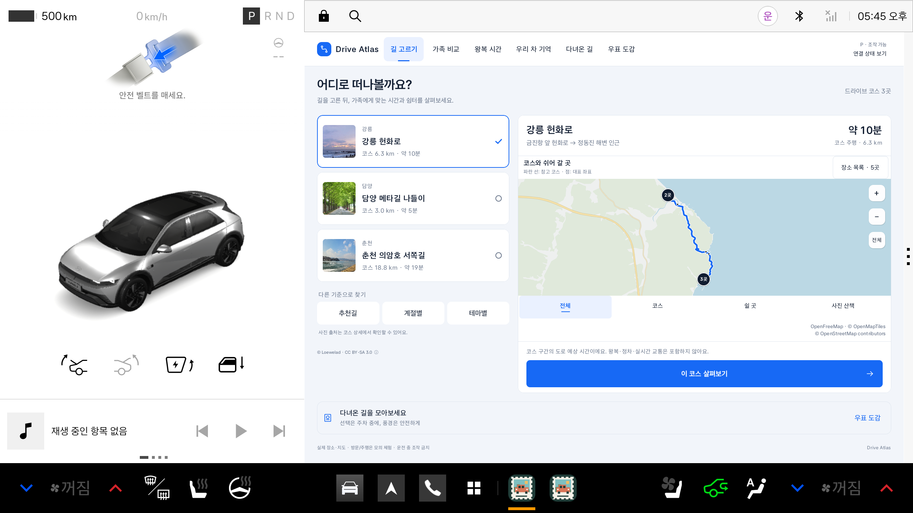
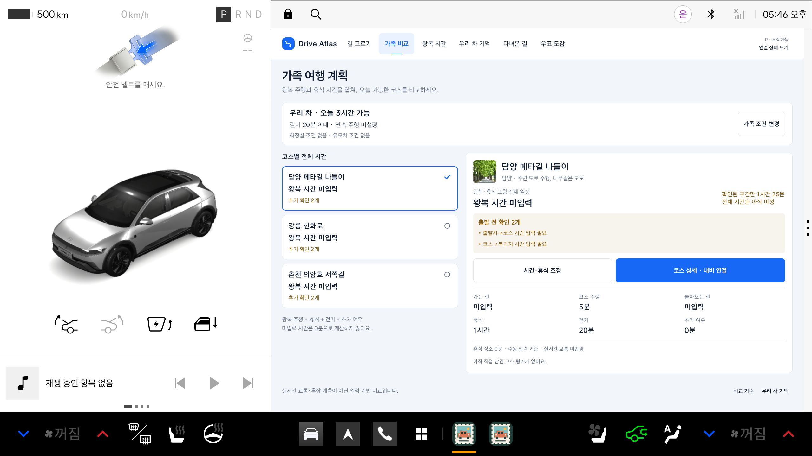

# DRIVE ATLAS

**가족의 시간과 이동 조건에 맞춰 드라이브 코스를 고르고, 왕복·휴식 계획과 여행의 기억을 연결하는 Pleos 차량용 앱입니다.**

SELTO SPOT · Hyundai 앱 개발 공모전 제출본 · `0.9.0-roundtrip`

[제출 APK](apk/SELTO%20SPOT_DRIVE%20ATLAS_release.apk) · [실행 방법](#실행-방법) · [테스트 환경](#테스트-환경과-설정) · [검증 결과](#검증-결과) · [상세 검증 보고서](docs/SUBMISSION_20261114.md)



*2026-11-14 제출용 release APK의 실제 실행 화면입니다. 공개 코스 지도를 표시하며, 현재 GPS 위치나 실제 주행 기록을 나타내지 않습니다.*

## 앱 소개

DRIVE ATLAS는 **길 고르기 → 가족 조건 비교 → 왕복·휴식 계획 → 내비 연결 → 여행 기억과 피드백**을 하나의 흐름으로 구성했습니다. Kotlin과 Jetpack Compose로 구현했으며, 차량의 주차 상태와 플랫폼 UX 제한을 확인한 뒤 조작할 수 있습니다.

| 기능 | 주요 내용 |
|---|---|
| 길 고르기 | 강릉 헌화로, 담양 메타길 나들이, 춘천 의암호 서쪽길 등 실제 국내 코스 3곳을 사진·도로 경로·장소 목록으로 살펴봅니다. |
| 가족 비교 | 사용 가능한 시간, 걷기와 연속 주행 한도, 화장실·유모차 조건을 기준으로 코스를 비교합니다. 미입력 시간과 추가 확인이 필요한 조건을 구분합니다. |
| 왕복·휴식 계획 | 가는 길·코스 주행·돌아오는 길에 휴식과 걷기 시간을 더합니다. 제출 release에서는 이동 시간을 직접 입력할 수 있으며, 실시간 교통 정보는 제공하지 않습니다. |
| 쉬어 갈 곳 | 출처를 확인한 장소의 화장실·접근성·운영 조건을 안내합니다. 시설별 사실과 확인 범위를 함께 표시합니다. |
| 내비 연결 | 네이티브 내비 검색, 전체 코스 요청, 개별 구간의 단일 목적지 요청을 구분합니다. 요청 전송만으로 길안내 성공을 표시하지 않습니다. |
| 우리 차 기억 | 차량 별명에 코스·만족도·메모를 연결하고 다음 추천에 참고합니다. 기록 수정·삭제 확인과 최대 500개 제한을 지원하며, 오래된 기록을 임의로 지우지 않습니다. |
| 안전한 조작 | 실제 P 기어와 플랫폼 UX 상태를 확인합니다. 신호가 없거나 오래되면 앱과 내부 웹 뷰어를 잠그며, 수동 주차 우회 기능은 제공하지 않습니다. |

### 가족 조건을 반영한 비교



*새 설치의 기본값을 사용한 release 화면입니다. 개인 가족 정보나 저장된 여행 기록은 없으며, 왕복 시간이 미입력된 상태를 확정 총시간으로 표시하지 않습니다.*

## 제출 APK

| 항목 | 제출 정보 |
|---|---|
| 앱 이름 / 팀 | **DRIVE ATLAS / SELTO SPOT** |
| APK 저장 위치 | **[`apk/SELTO SPOT_DRIVE ATLAS_release.apk`](apk/SELTO%20SPOT_DRIVE%20ATLAS_release.apk)** |
| 패키지 | `com.driveatlas.connected` |
| 버전 | `0.9.0-roundtrip` · versionCode `9` |
| 빌드 설정 | release · `DEBUG=false` · `SIMULATOR=false` |
| 서명 | 공모전 제출용 전용 인증서 · RSA-3072 · APK Signature Scheme v3 검증 완료 |

파일명에는 공백이 포함되어 있습니다. 터미널에서 사용할 때는 경로를 따옴표로 감싸 주세요. 이 APK는 디버그·디자인 검수용 앱과 구분되며, 디버그 전용 SIM 재생과 공개 OSRM 기반 온라인 예상시간 기능이 비활성화되어 있습니다.

**APK SHA-256**

```text
f23adf9035c5c84272b9db50ee89b6bc3a8fde75ab515d757e86cb6647dba910
```

**서명 인증서 SHA-256**

```text
b101e063524dd69eef74bd741bbd0fe8edff4880af9b61030cd6d909eca47827
```

인증서 지문은 공개 검증 정보이며 개인키가 아닙니다. 서명 키와 비밀번호는 저장소에 포함하지 않습니다.

## 실행 방법

### 1. Pleos 테스트 환경 준비

사용 권한이 있는 **Pleos 에뮬레이터와 필요한 차량 서비스**를 준비합니다. 검증에 사용한 버전과 화면 설정은 아래 [테스트 환경과 설정](#테스트-환경과-설정)을 참고해 주세요. Pleos 에뮬레이터 이미지와 SDK 소스 압축파일은 이 저장소에서 재배포하지 않습니다.

### 2. 제출 APK 설치 및 실행

저장소 루트에서 실행합니다. `adb devices -l`로 대상 기기를 확인한 뒤 `<selected-emulator-serial>`을 해당 기기의 시리얼로 바꿉니다.

```sh
adb devices -l
adb -s <selected-emulator-serial> install -r "apk/SELTO SPOT_DRIVE ATLAS_release.apk"
adb -s <selected-emulator-serial> shell am start -n com.driveatlas.connected/com.driveatlas.MainActivity
```

기존 앱과 서명이 충돌하면 먼저 설치 상태를 확인해야 합니다. 충돌을 피하기 위해 기존 앱을 임의로 삭제하거나 사용자 데이터를 초기화하지 마세요.

### 3. 주차·연결 상태 확인

- 앱은 **실제 P 기어와 플랫폼 UX 허용 상태**가 확인되어야 열립니다. 권한을 강제로 부여하거나 차량 상태를 조작해 이 제한을 우회하지 마세요.
- 지도는 선택 기능입니다. 연결 안내에서 동의한 후 공개 코스 지도가 표시되며, 이 설치의 동의 상태는 재실행 후에도 유지됩니다.
- 위치 이용, 외부 내비 연결, 온라인 경로 요청은 각각 별도 확인 절차를 거칩니다. 지도 연결만으로 현재 GPS 위치나 가족 기록을 전송하지 않습니다.
- 상단 메뉴에서 `길 고르기`, `가족 비교`, `왕복 시간`, `우리 차 기억`, `다녀온 길`, `우표 도감`으로 이동할 수 있습니다. 추천·계절·테마별 필터는 코스 목록 아래에 있습니다.
- 개별 내비 구간은 안전하게 주차한 뒤 직접 선택합니다. 이는 전체 코스의 자동 연속 길안내나 방문 인증이 아닙니다.

## 테스트 환경과 설정

**아래 환경에서 2026-11-14 제출용 release APK를 검증했습니다.**

| 항목 | 확인한 환경·설정 |
|---|---|
| Pleos 에뮬레이터 | **Pleos Connect 2.1.0** · `release_connect_v2.1.0` |
| 운영체제 | **Android 14 / API 34** |
| 디스플레이 | **2560 × 1440 / 160 dpi** |
| 차량·UX 상태 | 실제 서비스 응답: `P` · distraction restriction `false` · UX restrictions `0` |
| 앱 상태 | 새 release 설치, 저장된 여행 기록 0개 |
| 지도 연결 | OpenFreeMap 연결에 동의한 뒤 실제 지도 렌더링 확인 |
| 위치·외부 요청 | 위치 권한 미부여·미수집. 실제 길안내·온라인 예상시간 요청 없이 확인 |
| JDK / Gradle | JDK **17.0.20.1** / Gradle **8.10.2** |
| Android 빌드 SDK | compile SDK **35** / target SDK **35** / min SDK **28** |

지도 연결 시 공개 코스 지역 요청과 기기의 IP 주소가 OpenFreeMap/Cloudflare에 전달됩니다. 현재 GPS, 집 주소, 가족 기록은 지도 연결에 필요하지 않습니다. 서비스의 [이용약관](https://openfreemap.org/tos/)과 [개인정보 안내](https://openfreemap.org/privacy/)를 참고해 주세요.

## 소스 빌드

JDK 17과 Android SDK 35, Android Automotive 라이브러리가 필요합니다. 의존성 저장소는 Google, Maven Central, 공식 Pleos Maven이며 [설정 파일](settings.gradle.kts)에 명시되어 있습니다.

```sh
export JAVA_HOME=/path/to/jdk17
export ANDROID_HOME=/path/to/android-sdk

bash ./gradlew \
  :app:testDebugUnitTest :app:testReleaseUnitTest \
  :app:lintDebug :app:lintRelease \
  :app:assembleDebug :app:assembleRelease
```

- **디버그 APK:** `app/build/outputs/apk/debug/app-debug.apk`
- **디버그 패키지:** `com.driveatlas.connected.emulator`
- **release 빌드 중간 산출물:** `app/build/outputs/apk/release/app-release-unsigned.apk`
- **검증된 서명 APK:** `apk/SELTO SPOT_DRIVE ATLAS_release.apk`

소스를 다시 빌드한 APK는 제출용 서명 APK와 구분됩니다. 저장소만으로 제출용 개인키에 접근하거나 동일한 서명을 생성할 수 없습니다. `--offline`은 필요한 의존성이 이미 캐시되어 있을 때만 사용할 수 있으며, Android Studio에 포함된 JDK 25는 현재 프로젝트의 Gradle 8.10.2 구성과 호환되지 않습니다.

### 주요 구성

| 구성 | 역할 | 관련 소스 |
|---|---|---|
| Kotlin · Jetpack Compose | 화면 구성과 사용자 흐름 | [MainActivity](app/src/main/java/com/driveatlas/MainActivity.kt), [AtlasDesign](app/src/main/java/com/driveatlas/AtlasDesign.kt), [FamilyScreen](app/src/main/java/com/driveatlas/FamilyScreen.kt) |
| MapLibre Android | 공개 코스 지도와 장소 표시, 연결 동의 | [VectorCourseExplorer](app/src/main/java/com/driveatlas/VectorCourseExplorer.kt), [VectorMapConsent](app/src/main/java/com/driveatlas/VectorMapConsent.kt) |
| 가족 계획 · 로컬 저장 | 비교 조건, 시간 계획, 여행 기억과 복원 검증 | [FamilyModel](app/src/main/java/com/driveatlas/FamilyModel.kt), [FamilyStore](app/src/main/java/com/driveatlas/FamilyStore.kt), [RestoreValidation](app/src/main/java/com/driveatlas/RestoreValidation.kt) |
| Pleos · 차량 연동 | 주차·UX 제한, 내비 요청과 응답 검증 | [PleosConnections](app/src/main/java/com/driveatlas/PleosConnections.kt), [VehicleSafety](app/src/main/java/com/driveatlas/VehicleSafety.kt), [NativeRouteVerification](app/src/main/java/com/driveatlas/NativeRouteVerification.kt) |

## 검증 결과

다음은 [2026-11-14 제출 검증 기록](docs/SUBMISSION_20261114.md)의 결과입니다. 문서와 화면 이미지 정리를 위해 앱 소스나 빌드 설정을 변경하지 않았습니다.

| 검증 항목 | 결과 | 범위·주의사항 |
|---|---|---|
| Debug 단위 테스트 | **293개 통과** | 34개 suite, 실패·오류·건너뜀 0개 |
| Release 단위 테스트 | **293개 통과** | 동일한 293개 사례를 release에서 별도 실행, 실패·오류·건너뜀 0개 |
| Debug lint | **오류 0개** | 경고 18개, 정보 2개 |
| Release lint | **오류 0개** | 경고 16개, 정보 2개 |
| Debug · release 빌드 | **통과** | 제출용 APK 서명·정렬 검증 포함 |
| APK 설치·동일성 | **확인** | 설치된 `base.apk`와 제출 APK의 SHA-256 일치 |
| 화면·탐색 흐름 | **확인** | 지도 렌더링, 코스 3곳 선택·상세·뒤로가기, 가족 편집 닫기, 새 기억 취소·반복 뒤로가기 |
| 종료·재실행 | **확인** | 의도적인 강제 종료 후 재실행, 지도 동의 유지 |
| 앱 프로세스 로그 | 관찰 범위 내 `FATAL EXCEPTION` 없음 | 장시간 무오류 동작을 보증하는 결과는 아님 |

두 빌드의 단위 테스트는 **같은 293개 사례를 각각 실행한 결과**이며, 서로 다른 586개 테스트를 뜻하지 않습니다. 안전 상태, 위치 증거, 추천 순위, 시설 정보 범위, 미입력 이동 시간, 저장 실패·용량, 복원 검증, 내비 콜백 등을 다룹니다.

**이번 release 실행 검증에서 확인하지 않은 항목:** 기존 기억 수정·삭제, 새 기록 저장 후 복원, 실제 내비 길안내, GPS 수집, 실시간 교통, 다른 디스플레이, 계측 테스트, 실차 주행입니다. 새 기록을 만들지 않았으며 취소 후에도 기록 0개를 유지했습니다.

개발용 화면 점검 스크립트는 [tools/qa-design-workbench.py](tools/qa-design-workbench.py)에 있습니다. 과거 버전용 재생 스크립트(`qa-family-v08.py`, `qa-native-v08.py`, `qa-native-legs.py`)는 실행 중인 테스트 에뮬레이터에 모의 기록을 추가하거나 내비 경로를 바꿀 수 있습니다. 제출용 release 검증과 혼동하지 말고, 실차에서는 실행하지 마세요.

## 기능 범위와 한계

- **시간은 계획값입니다.** 직접 입력한 가는 길·복귀 시간과 코스의 도로 예상시간에는 실시간 교통이 반영되지 않습니다. 디버그 전용 공개 OSRM 기능은 요청별 동의, 출발·코스·복귀 구간 구분, 계획 적용 확인, 공개 기준점 전용 24시간 캐시를 갖춘 소규모 프로토타입이며 제출 release에서는 비활성화됩니다. 운영 서비스에는 적절한 별도 제공자가 필요합니다.
- **시설 안내는 현장 보증이 아닙니다.** 공개 자료에 근거한 화장실·접근성 정보는 실시간 이용 가능 여부나 코스 전체의 접근성을 보장하지 않습니다. 지도 기준점도 주차·정차 가능 장소로 인증하지 않습니다.
- **전체 코스 내비 검증에는 제한이 있습니다.** 확인한 네이티브 제공자는 경유지 이름과 최종 목적지가 맞아도 전체 코스 응답의 경유지 좌표를 `(0,0)`으로 반환합니다. 앱은 이 응답을 검증된 전체 길안내로 인정하지 않으며, 단일 목적지 요청과 별도로 처리합니다. [관련 조사](docs/NATIVE_NAVIGATION_V08.md)를 참고해 주세요.
- **위치 확인과 방문 인증을 구분합니다.** 승인된 GPS 근접 확인은 기기 안에서 처리하며, 현재 위치를 지도 서버에 자동 전송하지 않습니다. 에뮬레이터 GPS·내비·모의 기록은 실제 주행이나 방문의 증거가 아닙니다. 모의 기억은 표시를 구분하고 일반 만족도 집계에서 제외합니다.
- **공모전 제출용 구현입니다.** 클라우드 계정, 결제, 제휴 계약, 양산용 서명, 스토어 승인·출시, 실차 인증을 완료했다고 주장하지 않습니다.

## 데이터·라이선스

가족 조건과 여행 기억은 앱의 비공개 로컬 저장소에 보관하며 Android 백업을 비활성화했습니다. 공개 코스 사진의 저작자·라이선스 링크는 앱과 [코스·사진 출처](docs/REAL_ROADS_V04.md)에 유지합니다. 지도에는 OpenFreeMap, OpenMapTiles, OpenStreetMap 기여자 표시를 제공합니다.

이 README의 두 화면은 제출용 release APK에서 캡처한 원본 PNG를 편집 없이 선별한 것입니다. 공개 코스와 새 설치의 기본값만 포함하며, 개인 가족 정보·현재 GPS·저장된 여행 기록은 포함하지 않습니다. 화면 속 사진의 저작자와 라이선스는 위 출처 문서를 참고해 주세요.

서명 키, 로컬 설정, SDK 소스 압축파일, 검증 로그·XML과 원본 증거 폴더, 중간 빌드 산출물은 소스 공개 대상에서 제외합니다. 빌드 산출물 중에는 검토한 제출용 서명 APK만 `apk/`에 포함합니다.

## 관련 문서

| 문서 | 내용 |
|---|---|
| [제출 검증 보고서](docs/SUBMISSION_20261114.md) | 최종 APK, 빌드·실행 검증 범위, 소스 참조와 제출 안내 |
| [2026-11-13 화면 정리](docs/DESIGN_REFINEMENT_20261113.md) | 최신 화면 개선 내용과 당시 검증 |
| [왕복 계획 0.9](docs/ROUNDTRIP_V09.md) · [차량·release 준비](docs/VEHICLE_RELEASE_READINESS.md) | 왕복 계획과 차량 연동의 구현 범위 |
| [가족 기능 0.8](docs/FAMILY_V08.md) · [내비 연동 조사](docs/NATIVE_NAVIGATION_V08.md) · [Pleos 연동](docs/PLEOS_CONNECTED_V05.md) | 기능별 구현·검증 이력 |
| [화면 설계 배경](docs/NATIVE_ATLAS_DESIGN.md) | 초기 워크벤치 설계와 출처 적용 근거 |
| [코스·사진 출처](docs/REAL_ROADS_V04.md) · [휴식 장소 출처](docs/REST_ROUTING_SOURCES.md) | 공개 데이터, 사진 라이선스, 시설 정보의 근거 |

과거 날짜의 문서는 해당 시점의 결과를 보존합니다. **현재 제출본의 환경과 검증 상태는 이 README와 2026-11-14 제출 검증 보고서를 기준으로 확인해 주세요.**
